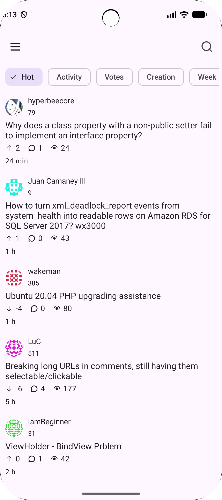
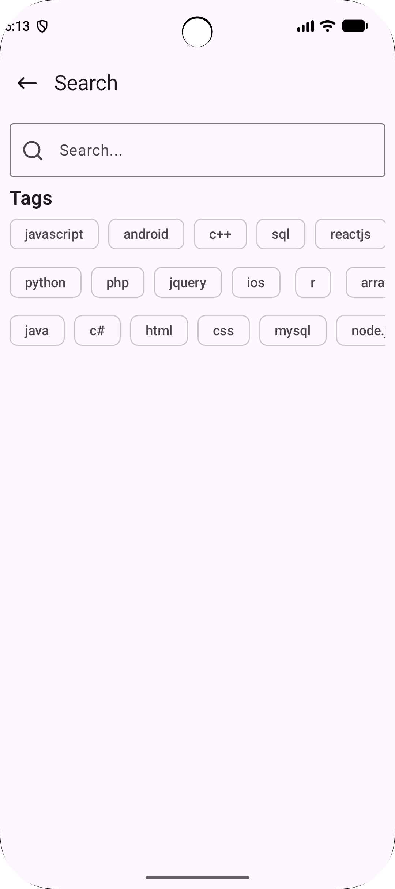
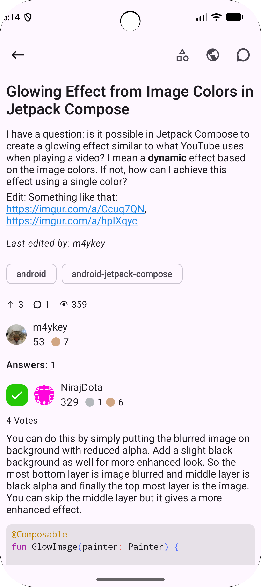
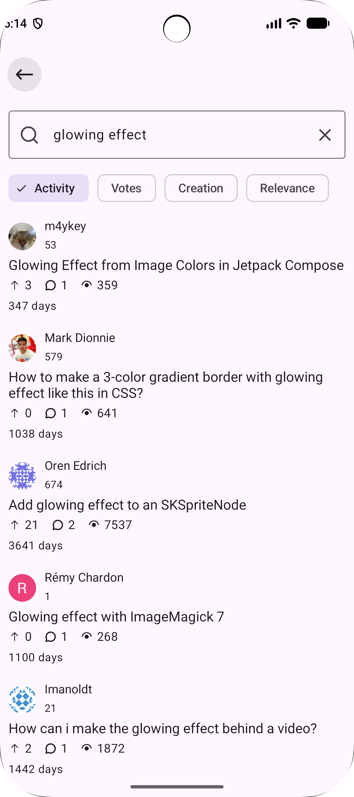
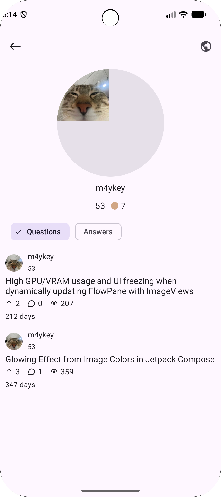

## Stos

Stos is a cross-platform application (Android and Desktop) built with **Kotlin Multiplatform** that helps
you solve your programming problems using **StackExchange** and **StackOverflow**.

## Features
- Browse and search questions and answers from StackOverflow and other StackExchange sites
- Readable rendering of posts, including formatted text and code
- One shared codebase for Android and Desktop built with Compose Multiplatform

## Screenshots
| Home                                               | Search                                              | 
|----------------------------------------------------|-----------------------------------------------------|
|      |            |

| Detail                                             | Search List                                         |
| ------------------------------------------------   | -------------------------------------------         |
|  |  |

| User                                               |
| ------------------------------------------------   |
|               |

## Supported Platforms

| Platform       | Status    |
|----------------|-----------|
| Android        | Supported |
| Desktop (JVM)  | Supported |
| IOS            | Not yet   |

## Project Setup
1. Clone repository and open in the latest version of Android Studio
2. Create ```local.properties``` file
3. Add your [StackExchange](https://api.stackexchange.com/docs) key:
```
k=YOUR_KEY
```