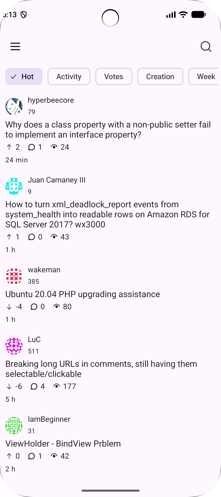
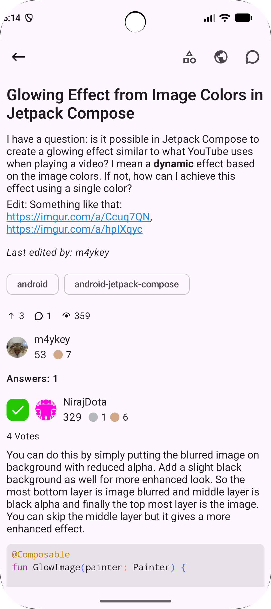
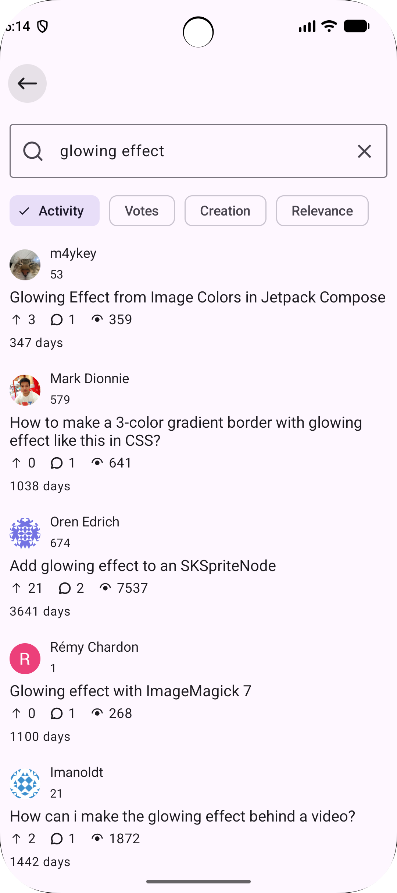
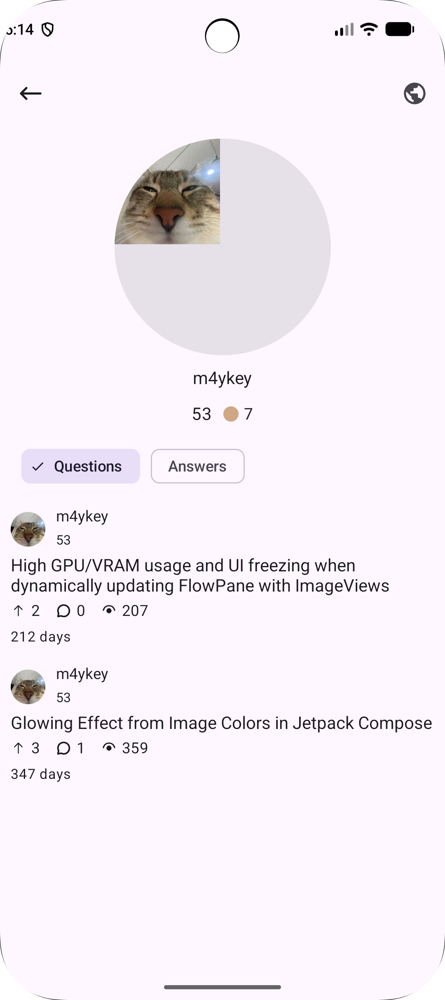
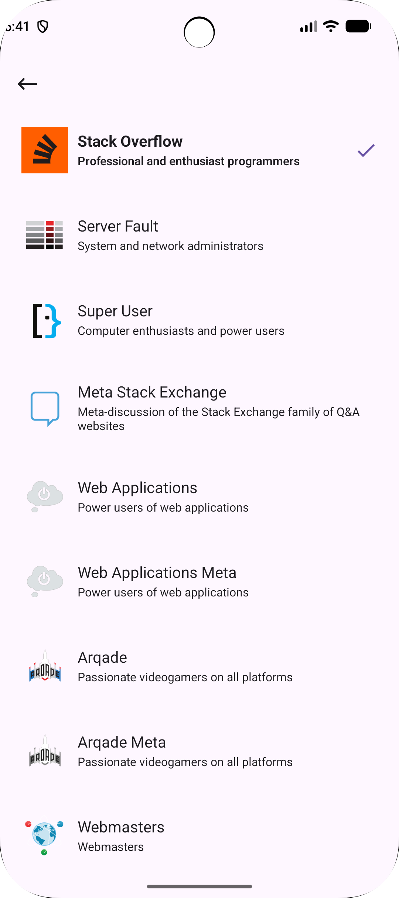

# Stos

Stos is a cross-platform application (Android and Desktop) built with **Kotlin Multiplatform** that helps
you solve your programming problems using **StackExchange** and **StackOverflow**.

## Features
- Browse and search questions and answers from StackOverflow and other StackExchange sites
- Readable rendering of posts, including formatted text and code
- One shared codebase for Android and Desktop built with Compose Multiplatform
- View user profiles
- Switch between StackExchange sites

## Screenshots
| Home                                               | Search                                              | 
|----------------------------------------------------|-----------------------------------------------------|
|      |            |

| Detail                                             | Search List                                         |
| ------------------------------------------------   | -------------------------------------------         |
|  |  |

| User                                  | Sites                                   |
|---------------------------------------|-----------------------------------------|
|  |  |

## Roadmap
- [ ] iOS Support
- [ ] Bookmarks / offline reading
- [ ] Authentication

## Supported Platforms

| Platform       | Status    |
|----------------|-----------|
| Android        | Supported |
| Desktop (JVM)  | Supported |
| iOS            | Not yet   |

## Requirements
- Android Studio (latest stable)
- JDK 21+
- StackExchange API Key (optional, increases the request quota)

## Project Setup
1. Clone repository and open in the latest version of Android Studio
2. (Optional) Create `local.properties` file and add your [StackExchange API key](https://api.stackexchange.com/docs)
``` properties
k=YOUR_KEY
```

## Inspiration
This project was created out of desire to learn new technologies, and was inspired by
[Stack](https://github.com/tylerbwong/stack).

## Disclaimer
Stos is not affiliated with Stack Exchange, Inc. Content is provided by the StackExchange API and is licensed under CC BY-SA.